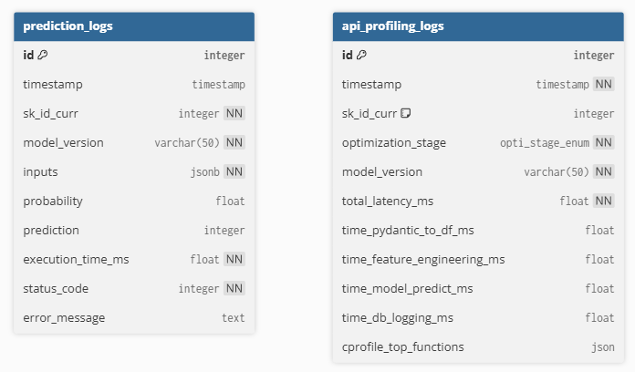

<a id="readme-top"></a>

# Projet 8
Confirmez vos compétences en MLOps (Partie 2/2)

## A propos du projet

Ce projet simule la mise en production d'un modèle de scoring via le CI/CD (Continuous Integration et Continuous Deployment)  en l'exposant via une API.

Le développement a été effectué sur un système d'exploitation Windows.

Le projet comprend :
- un modèle de scoring de crédit
- une API qui permet d'intéragir avec le modèle de prédiction
- une base de données Redis qui va contenir en cache les agrégations des données historiques pour accélérer l'inférence du modèle
- une base de données PostgreSQL pour logger les intérations entre l'utilisateur et l'API ainsi que le profilage de l'inférence du modèle
- une interface client (gradio) de démonstration pour intéragir avec l'API
- un notebook d'analyse des dérives des données
- une interface (streamlit) d'analyse de profilage des performances du modèle 
- les tests unitaires
- un pipeline CI/CD

### Le modèle de prédiction
Le modèle a pour but de calculer la probabilité qu'un client rembourse un crédit, puis classifie la demande en crédit accordé ou refusé. 
Il a été entrainé sur les données du fichier 'Application_train.csv' ainsi que les données historiques :
- 'bureau_balance.csv'
- 'bureau.csv'
- 'credit_card_balance.csv'
- 'installments_payments.csv'
- 'POS_CASH_balance.csv'
- 'previous_application.csv'

Il s'agit du modèle de machine learning [**LightGBM**][lightGBM-url].

#### Entraînement du modèle
L'entraînement du modèle de prédiction se fait via le projet 6 *Initiez-vous au MLOps (partie 1/2)*.
Celui-ci se déroule en plusieurs étapes :
- La lecture des données d'entraînement : Initialement fait à partir de la lecture du fichier CSV *application_train.csv*. 
- Le nettoyage des données manquantes et valeurs aberrantes
- La suppression des features inutiles
- L'application du feature engineering
- l'agrégation des données historiques qu'on retrouve dans les fichiers cités précédemment
- La création du pipeline de prétraitement (encodage + sélection features), d'une fonction de coût métier, ainsi que du modèle
- La séparation du jeu de données en deux : un jeu d'entraînement et un de test (80 % - 20%)
- L'entraînement du modèle sur le jeu d'entraînement
- L'évaluation du modèle sur le jeu de test
- Optimisation des hyperparamètres du modèle
- Optimisation du seuil de décision en fonction du coût métier
- Trace des hyperparamètres, évaluations, modèles dans MLFlow
- Enregistrement du modèle entrainé dans le fichier */models/model.skops* pour l'utilisation de celui-ci en production

**Note** : Les résultats de l'évaluation du modèle sur les données d'entraînement originales sont :
- ROC-AUC : 0.7856687213408715
- Précision : 0.18419240345393867
- Recall : 0.7003021148036254
- F1_score : 0.29167016189916956
- Coût métier : 0.4923 €/client

#### Modèle en production
En production, le modèle est exposé via une API où il est possible d'exécuter la requête `/predict` pour calculer la probabilité de remboursement ainsi que l'accord / refus du prêt. L'exécution se déroule alors de la façon suivante :
- Validation des données envoyées dans la requête via la librairie [*Pydantic*][pydantic-url]
- Reconstruction l'ensemble des features pour le calcul de la prédiction :
    - Récupération des données historiques dans la base Redis
    - Prétraitement des données d'entrées (nettoyage, calcul ratios financiers, ...)
    - Calcul des polynomiales features
    - encodage des données catégorielles
- Prédiction des valeurs de sorties (probabilité + accord / refus)
- Logs de l'inférence dans la base de données PostgreSQL
- (Si profilage activé) Logs des résultats du profilage de la requête dans la base de données PostgreSQL
- Réponse du résultat à l'utilisateur

<p align="right">(<a href="#readme-top">back to top</a>)</p>

### API
Schéma d'architecture :


L'API expose le modèle de prédiction. Il y a au total quatre endpoints :


Etant donné que le déploiement de l'API en production est simulée, l'adresse est la même que sur l'environnement de développement :
<code>http://localhost:8000</code>

Pour plus de détails sur les différents endpoints (schémas requis, codes erreurs, etc.), veuillez vous référer à la documentation OpenAPI générée pour l'API en ajoutant `/docs` à l'adresse URL ex : [`http://localhost:8000/docs`][local-api-url]

<p align="right">(<a href="#readme-top">back to top</a>)</p>

### Programmation

   * [Python V3.14][python-url]
   * [Package manager : uv][uv-url]
   * [Versionning : GIT][git-url]
   * [Base de données : PostgreSQL][postgresql-url]
   * [Cache : Redis][redis-url]

### Plateformes

   * [VS Code][vscode-url]
   * [Docker desktop][docker-url]
   * [Github][github-url]
   * [Github action runner][action-runner-url]

<p align="right">(<a href="#readme-top">back to top</a>)</p>

## Prérequis

   Avant de commencer le projet, veuillez préparer correctement votre environnement de développement.

      1. Installez Python version V3.12
      2. Installez Visual Studio Code, ainsi que ses extensions Python (python, python debugger, ...)
      3. Installez Docker desktop
      4. Installez le système de contrôle de version Git
      5. Installez le manager de packages et d'environnements UV

### Installation package manager UV

Ouvrez la console Powershell et tapez la commande suivante pour installer UV :

   ```sh
   powershell -ExecutionPolicy ByPass -c "irm https://astral.sh/uv/install.ps1 | iex"
   ```
   
### Installation du action runner

Afin de simuler le déploiement de l'API en production, nous utilisons un 'self hosted action runner' fourni par Github. Cet outil va nous permettre "d'écouter" les étapes de déploiement que le Github action cherche à exécuter et déployer alors les différents conteneurs sur le docker desktop de la machine local.

Veuillez suivre les étpes de l'installation de l'action runner en cliquant [**ici**][action-runner-url]. 

### Cloner le projet depuis le repo GitHub

Pour commencer à travailler en local sur le projet, veuillez cloner celui-ci avec la commande suivante (via GIT bash) :

   ```sh
   git clone https://github.com/clementghoris-cpu/Projet-8.git
   ```

<p align="right">(<a href="#readme-top">back to top</a>)</p>

## Organisation des branches
- La documentation se fait dans les branches `docs`
- La branche principale de développement est `develop`. Les nouvelles fonctionnalités sont développées directement dans celle-ci
- la branche `main` sert au déploiement sur l'environnement de *production*. Elle est mise à jour automatiquement après une pull request de la branche develop vers main et que les tests unitaires soient validés

### Convention pour les commits
La structure d'un message de commit se fait de la façon suivante :

```sh
   <type> (cible) : description

   Exemple : feat (api) : modifier le format de la reponse de l'endpoint /predict
```

#### Les principaux types
- **`feat`** : Nouvelle fonctionnalité
- **`fix`** : Correction d'un bug
- **`docs`** : Changement dans la documentation
- **`refactor`** : Modification du code qui ne corrige rien et n'ajoute rien
- **`test`** : Ajout ou modification de tests
- **`chore`** : Tâches répétitives, mise à jour de dépendances, configuration des outils

<p align="right">(<a href="#readme-top">back to top</a>)</p>

## Environnement de développement
Il y a deux environnements différents :
   - l'environnement de *développement* (en local), qui va nous permettre de tester l'application via des conteneurs Docker   
   - L'environnement de *production* dans lequel le projet sera automatiquement déployé après avoir réussi l'ensemble des tests

### Déploiement sur l'environnement de développement
Le déploiement de l'application sur l'environnement de développement se fait dans les conteneurs Docker.
Nous avons au total 7 conteneurs qui peuvent être utilisés : 
   - **redis** : Base cache pour stocker les pré-calculs d'agrégation
   - **regis-insight** : qui permet l'administration de la base redis
   - **api** : qui est l'application permettant d'exposer le modèle
   - **postgres** : qui contient la base de données postgreSQL
   - **pgadmin** : qui permet l'administration de la base de données 
   - **gradio** : qui est l'interface client pour tester le modèle de prédiction
   - **streamlit** : qui est l'interface d'analyse de profilage de l'inférence du modèle

Les conteneurs sont configurés via le fichier Dockerfile pour l'API et les fichiers docker-compose.yml et docker-compose.test.yml.

Pour déployer les containers, utilisez la commande :
   ```sh
   docker compose -f docker-compose.yml -f docker-compose.test.yml up -d [api] [db] [pgadmin] [trainer] --build
   ```

Pour démarrer la totalité des conteneurs, il n'est pas utile de spécifier chaque nom de container. `--build` permet de recompiler les conteneurs après une modification de code.

<p align="right">(<a href="#readme-top">back to top</a>)</p>

## CI / CD (intégration continue / déploiement continu)
Le déploiement sur l'environnement *production* se fait via le pipeline intégration continue / déploiement continu.

Les étapes du CI / CD se font de la façon suivante :


1. Après un commit sur la branche `develop`, l'utilisateur fait un push vers le dépôt GitHub
2. L'utilisateur crée une *pull request* pour fusionner le code de la branche `develop` vers la branche `main`
3. Le workflow défini dans le fichier **.github/workflows/ci-cd.yml** se déclenche automatiquement dans une action GitHub et déclenche les tests unitaires définis dans le dossier ***/tests/units/***
4. Si les tests passent :
   1. Une nouvelle *release* (Tag) est créée
   2. Le déploiement se fait vers l'environnement de *production*

### Fichier *ci-cd.yml*
- Déclenchement sur une *pull request* vers la branche `main`
- Jobs :
   - analyse et tests :
      1. Récupération du dépôt (*checkout*)
      2. Installation de Python
      3. Installation du package manager UV
      4. Installation des dépendances
      5. Vérification de la qualité du code (Ruff)
      6. Exécution des tests unitaires
    - Création tag :
      1. Récupération du dépôt (*checkout*)
      2. Génération du tag de version
    - Déploiement :
      1. Récupération du dépôt (*checkout*)
      2. Déploiement via Docker compose

<p align="right">(<a href="#readme-top">back to top</a>)</p>

### Variables d'environnement et secrets
Pour protéger l'accès à la base de données et aux environnements, plusieurs variables d'environnement et secrets sont créées.

#### Fichier .env
Il est utilisé uniquement dans l'environnement de développement, pour configurer l'accès à la base de données PostgreSQL, Redis, au service *pgAdmin* et à l'API qui seront déployés dans Docker. Il est ignoré du dépôt et donc n'est pas transféré sur GitHub. Néanmoins, pour savoir comment ce fichier doit être rempli sur votre environnement, il y a un fichier d'exemple ***.env.example***.

#### Github secrets
Dans les paramètres du dépôt sur GitHub, l'environnement *production* a été créé pour y insérer 
- les variables secrets :
    1. **PGADMIN_EMAIL** : Nom d'utilisateur interface d'administration pgadmin
    2. **PGADMIN_PASSWORD** : Mot de passe interface d'administration pgadmin
    3. **POSTGRESQL_PASSWORD** : Mot de passe de la base de données PostgreSQL
    4. **POSTGRESQL_USER** : Nom d'utilisateur de la base de données PostgreSQL
    5. **REDIS_PASSWORD** : Mot de pass de la base Redis
- les variables d'environnement :
    1. **API_ENABLE_CPROFILE** : Flag d'activation du profilage d'inférence de la prédiction
    2. **API_LOGS_INFERENCE_ROUTE** : Route de la requête des logs d'inférence
    3. **API_LOGS_PROFILING_ROUTE** : Route de la requête des logs de profilage
    4. **API_PORT** : Numéro du port de l'API
    5. **API_PREDICT_ROUTE** : Route de la requête de prédiction
    6. **API_URL** : Adresse URL de l'API
    7. **POSTGRESQL_DB** : Nom de la base de données PostgreSQL
    8. **POSTGRESQL_HOST** : Adresse de la base de données PostgreSQL
    9. **POSTGRESQL_PORT** : Numéro du port de la base de données PostgreSQL
    10. **REDIS_DB** : Nom de la base Redis
    11. **REDIS_HOST** : Adresse de la base Redis
    12. **REDIS_PORT** : Port de la base Redis

**Remarques** : ces secrets sont référencés dans les fichier ***ci-cd.yml*** 

<p align="right">(<a href="#readme-top">back to top</a>)</p>

## Tests unitaires
Les tests unitaires permettent d'isoler chaque méthode et on vérifier son comportement pour différentes entrées.
Ils ont été programmé avec la librairie [Pytest][pytest-url].

Pour l'environnement de développement, il est possible de lancer les tests avec la commande suivante :
```sh
   uv run pytest .\tests\[units\][integration\]
```

Sinon, ils sont exécutés automatiquement via le CI / CD. Les tests unitaires sont exécutés lorsqu'on fait une pull request vers la branche `main`.

<p align="right">(<a href="#readme-top">back to top</a>)</p>

## Base de données
### PostgreSQL
La base de données est utilisée pour deux raisons :
- Logger les profilages d'inférence du modèle
- Logger les interactions entre l'API (données d'entrée de la requête) et le modèle (résultat de la prédiction)

Nous avons 2 tables :
- une table `prediction_logs` : pour logger les intéractions entre l'API et le modèle
- une table `api_profiling_logs` : pour logger les données de profilage

 

L'interface d'accès à la base de données est programmée dans le script `src/database/database_access.py`.

<p align="right">(<a href="#readme-top">back to top</a>)</p>

### Redis
La base Redis permet de stocker en cache les données historiques agrégées pré-calculés pour accélérer l'inférence du modèle lors de la requête `/predict`.

Afin de remplir cette base Redis, plusieurs étapes doivent êre exécutées :
1. Pré-calcul de l'agrégation des données historiques et sauvegarde dans un fichier CSV
2. Lecture du fichier CSV et import dans la base Redis

#### Pré-calcul de l'agrégation des données historiques
Pour chaque fichier historique cité précédemment, un script pour calculer les agrégations y est associé. 
On retrouve l'ensemble des scripts dans le dossier ***src/data/historic***. 
On a au total 5 scripts :
- *bureau_aggregation.py*
- *credit_card_balance_aggregation.py*
- *installments_payments_aggregation.py*
- *pos_cash_balance_aggregation.py*
- *previous_application_aggregation*

Pour lire l'ensemble des fichiers, exécuter les calculs et sauvegarder les résultats dans un CSV, le script *historic_pipeline.py* a été créé. Exécutez la commande suivante pour exécuter le script :
```sh
   uv run python -m src.data.historic.historic_pipeline
```

Le fichier `historic_aggregation.csv` est alors généré dans le dossier ***data/processed***.

#### Import dans la base Redis
Le script `src/data/cache` permet de lire le fichier CSV généré précédemment et d'importer ces données dans la base Redis.
Pour exécuter le script, tapez la commande suivante :
```sh
   uv run python -m src.data.cache.aggregation_to_cache_pipeline
```

## Interface démo (Gradio)
Une interface client a été créée à des fins de démonstration pour montrer le fonctionnement d'un appel à *l'endpoint* `/predict`. Le script a été créé avec [gradio][gradio-url] dans le fichier ***src/frontend/formulaire.py***.

Un conteneur a été créé pour excécuter cette interface. Rendez-vous à l'adresse <code>http://localhost:7860</code>. L'interface vous permet de sélectionner plusieurs exemples de données et d'exécuter une requête `/predict` vers l'API. Celle-ci retournera la prédiction en réponse.

## Analyse de la dérive des données
L'analyse de la dérive des données est faite dans le notebook `monitoring/drift analysis.ipynb`. La bibliothèque [Evidently][evidently-url] est utilisée pour faire cette analyse entre les données d'entrainement et les données d'inférence.

Les données d'entrainement proviennent du projet 6 et on été sauvegardé (après nettoyage, feature engineering, encodage) dans un fichier CSV. Il n'est pas repris dans le dépôt car la taille du fichier est trop grande. 

Les données d'inférence sont quand à elles récupérée dans la base de données PostgreSQL via la requête `/logs/inference-data` l'API.

Un rapport est alors généré dans le notebook où on peut y observer la dérive pour le Top 25 des features les plus importantes.

## Analyse profilage de l'inférence (Streamlit)
Une interface pour l'analyse du profilage de l'inférence a été créée en [streamlit][streamlit-url] et déployé dans un conteneur. Elle est accessible à l'adresse <code>http://localhost:8501</code>.

Cette interface va afficher la comparaison de vitesse de traitement de la requête `/predict` en fonction des différentes optimisations du modèle et du pré-traitememnt des données. Ces données de profilages sont stockées dans la base de données PostgreSQL et sont récupérées via la requête `/logs/profiling` de l'API.

Il y a au total 3 points de comparaison :
- **Baseline** : qui est l'exécution de la requête `/predict` de base sans optimisation
- **OPTI_1** : qui optimise l'appel des méthodes de logs de façon asynchrone
- **OPTI_2** : qui va accélérer le pré-traitement des données en exécutant celui-ci via un dictionnaire plutôt qu'un dataframe Pandas

Le profilage augmentant également la durée de traitement de la requête de quelques millisecondes, il est possible de désactiver ce profilage via le flag `API_ENABLE_CPROFILE` défini dans les variables d'environnement.


<p align="right">(<a href="#readme-top">back to top</a>)</p>

[lightGBM-url]:https://lightgbm.readthedocs.io/en/latest/index.html
[pydantic-url]:https://pydantic.dev/docs/
[local-api-url]:http://localhost:8000/docs
[python-url]:https://www.python.org/
[uv-url]:https://docs.astral.sh/uv/
[git-url]:https://git-scm.com/
[action-runner-url]:https://github.com/clementghoris-cpu/Projet-8/settings/actions/runners/new
[postgresql-url]:https://www.postgresql.org/
[redis-url]:https://redis.io/
[vscode-url]:https://code.visualstudio.com/download?_exp_download=fb315fc982
[docker-url]:https://www.docker.com/products/docker-desktop/
[github-url]:https://github.com/
[render-url]:https://render.com/
[streamlit-url]:https://streamlit.io/
[gradio-url]:https://gradio.app/
[evidently-url]:https://www.evidentlyai.com/
[pytest-url]:https://docs.pytest.org/en/stable/
[ruff-url]:https://docs.astral.sh/ruff/linter/